# Caches

C++23 library with LRU, LFU, ARC, LIRS, 2Q, inclusive/exclusive multi-level
caches, and an offline IDEAL reference.

## Requirements

- Linux
- GCC 14+
- CMake 3.28+
- Ninja 1.11+
- Git and internet access to fetch GoogleTest (tests) and CLI11 (runner)
  through CPM.cmake
- Python 3 with `venv` when `BUILD_BENCHMARKS=ON` (`python3-venv` on Debian/Ubuntu)

## Build

Configure from the repository root:

```bash
cmake -S . -B build -G Ninja -DCMAKE_CXX_COMPILER=g++-14 \
  -DCMAKE_BUILD_TYPE=Release -DBUILD_BENCHMARKS=ON
```

For library only, use `-DBUILD_TESTS=OFF -DBUILD_BENCHMARKS=OFF`.

Build:

```bash
cmake --build build -j2
```

With `BUILD_BENCHMARKS=ON`, the build creates `.venv` and installs Matplotlib
via pip. Setup reruns when `benchmarks/CMakeLists.txt` changes or `.venv` is
removed.

Run tests:

```bash
ctest --test-dir build --output-on-failure
```

## Benchmark

Python calls the C++ runner to compare hit rates across traces and cache budgets.
It tests all ordered policy combinations, including repetitions: 5, 25, or 125
strategies for 1, 2, or 3 levels. IDEAL uses one cache with the same total budget.

Exclusive hierarchies are the default. With `--inclusive`, total hit rate
depends on the last level.

[50 synthetic traces](benchmarks/traces/README.md) are included, each with a
key space of 4,096 keys and 8,192 requests.
Trace format: positive key-space size, positive request count, then the integer
keys, one value per line.

```bash
.venv/bin/python benchmarks/benchmark.py \
  --levels 1 2 3 --step 0.05 --max-ratio 0.3 \
  --output results/comparison
```

| Argument | Default | Description |
| --- | --- | --- |
| `--data-dir PATH` | `benchmarks/traces` | Input trace directory. |
| `--pattern GLOB` | `*.txt` | Trace filename filter; quote patterns, e.g. `'16_*'`. |
| `--runner PATH` | `build/benchmarks/cache_bench_runner` | C++ runner executable. |
| `--levels N [N ...]` | `1 2 3` | Level counts: 1, 2, or 3. |
| `--exclusive` | On | Use an exclusive hierarchy. |
| `--inclusive` | Off | Use an inclusive hierarchy; excludes `--exclusive`. |
| `--split-2 W1 W2` | `1 3` | Capacity weights for two levels, L1 first. |
| `--split-3 W1 W2 W3` | `1 2 5` | Capacity weights for three levels, L1 first. |
| `--step RATIO` | `0.05` | Cache/data ratio step; `0 < RATIO <= 1`. |
| `--max-ratio RATIO` | `1` | Maximum total budget / key-space size; `0 < RATIO <= 1`. |
| `--top N` | `10` | Positive limit on distinct curves and ranking bars; line plots also show IDEAL. |
| `--output PATH` | `results/benchmark` | Output directory; must not already exist. |
| `-h`, `--help` | — | Show help and exit. |

### Output

- `results.csv`: all measurements and IDEAL hit rates.
- `<trace>.png`: hit rate (%) against actual budget / key-space size.
- `ranking.csv` and `ranking.png`: overall strategy scores.
- `ranking_by_ratio.csv` and `ranking_by_ratio.png`: scores across traces at
  each requested ratio.

Line plots select the highest mean curves and show identical curves once.
CSV files keep all strategies.

### Score

Scores compare miss counts with IDEAL:

```text
miss_ratio      = (requests - ideal_hits) / (requests - hits)
trace_log_ratio = mean(log(miss_ratio) over distinct budgets in one trace)
score           = 100 * exp(mean(trace_log_ratio over traces))
score_at_ratio  = 100 * exp(mean(log(miss_ratio_at_ratio) over traces))
```

Traces have equal weight, as do distinct budgets within each trace.
100 matches IDEAL; 50 means twice as many misses on a weighted geometric average.
Scores are not hit-rate percentages. IDEAL is excluded from the ranking.

## C++ runner

Prints `strategy hits requests` per combination. Policy names run from L1
downwards, e.g. `lru>arc`.

```bash
./build/benchmarks/cache_bench_runner \
  --trace benchmarks/traces/10_database_mixed.txt --capacities 64 192
```

| Argument | Description |
| --- | --- |
| `--trace PATH` | Required trace file in the format above. |
| `--capacities N [N ...]` | Required: 1–3 positive, nondecreasing integer capacities, from L1 downwards. |
| `--ideal` | Run only IDEAL; requires exactly one capacity. |
| `--exclusive` | Use an exclusive hierarchy (default). |
| `--inclusive` | Use an inclusive hierarchy. |
| `-h`, `--help` | Show help and exit. |

`--ideal`, `--exclusive`, and `--inclusive` are mutually exclusive.

## Research

Inclusive hierarchies are excluded from this study. In this implementation,
their total hit rate equals that of a standalone cache with the last level's
policy and capacity: upper-level entries are also present in the last level,
and every request updates that level.

The results use the current [50-trace dataset](benchmarks/traces/README.md),
with 4,096 keys and 8,192 requests per trace. Total cache budgets range from
0.5% to 30% of the key space in steps of 0.5 percentage points: 60 points per
trace.

The initial decline in **Rating by ratio** comes from comparison with IDEAL.
Hit rates generally rise with capacity, but the score falls when IDEAL reduces
its misses faster proportionally. For example, from a 0.5% to a 5.5% budget,
ARC's mean hit rate across traces rises from **12.5% to 36.3%**, while its
score falls from **84.4 to 71.8**. The best overall strategies for one,
two, and three levels all reach their sampled minimum at **5.5%** (225 entries).
Across all 155 strategies, minima range from 5% to 10%.

### All strategies

Among all 155 configurations, single-level ARC has the highest overall score
(**75.378**), ahead of the best two-level (**73.681**) and three-level
(**73.207**) strategies. ARC also leads the per-ratio ranking at all 60 sampled ratios. 

ARC is the best overall choice, but the best strategy for a specific case may
vary with the access pattern, cache budget, number of levels, and capacity split.

Each figure group below shows the overall ranking at the top left and the score
versus cache/data ratio at the top right. The two hit-rate plots below are just
examples, with no special significance attached to the choice of traces.
The rankings use all 50 traces.

<table>
  <tr>
    <td width="50%" align="center" valign="top">
      <strong>Overall ranking</strong><br>
      <a href="assets/all/ranking.png">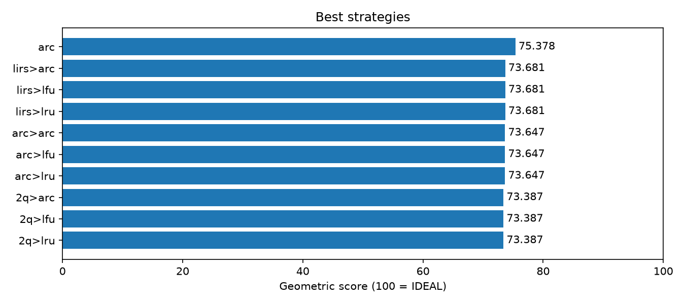</a>
    </td>
    <td width="50%" align="center" valign="top">
      <strong>Rating by ratio</strong><br>
      <a href="assets/all/ranking_by_ratio.png">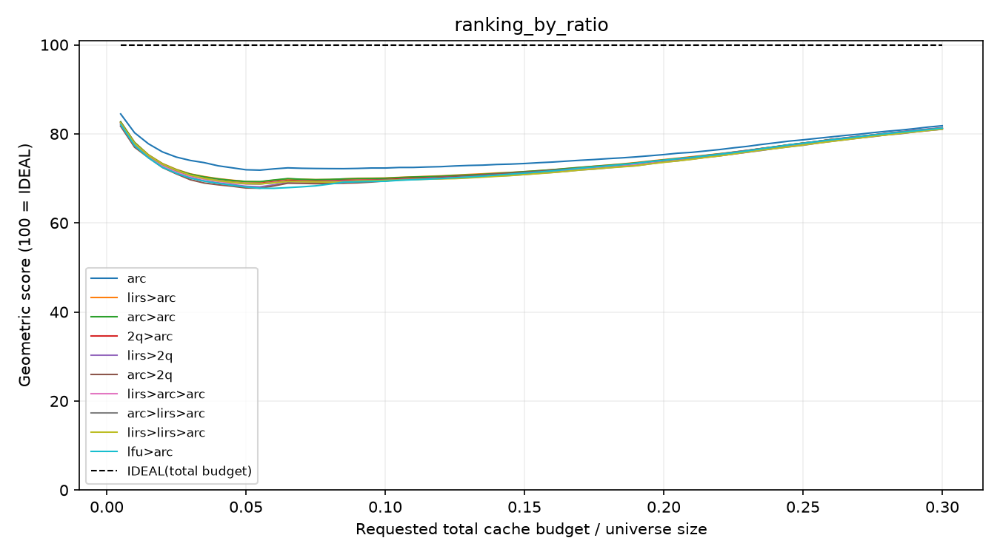</a>
    </td>
  </tr>
  <tr>
    <td width="50%" align="center" valign="top">
      <strong>Trace 12: Alternating hot regions</strong><br>
      <a href="assets/all/12_alternating_hot_regions.png">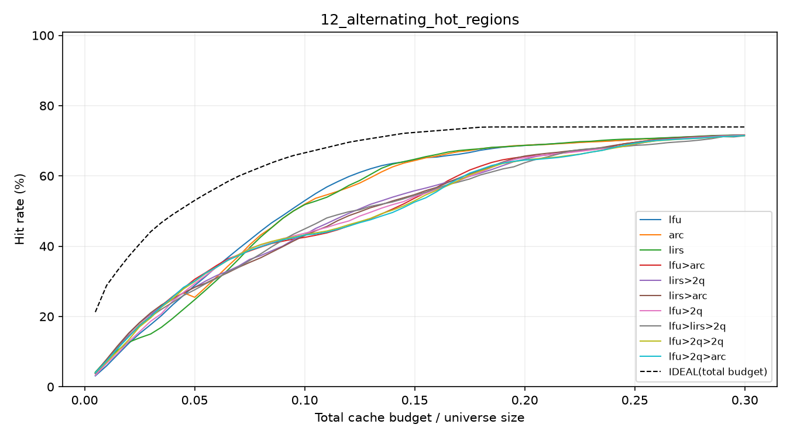</a>
    </td>
    <td width="50%" align="center" valign="top">
      <strong>Trace 18: Web sessions with noise</strong><br>
      <a href="assets/all/18_web_sessions_with_noise.png">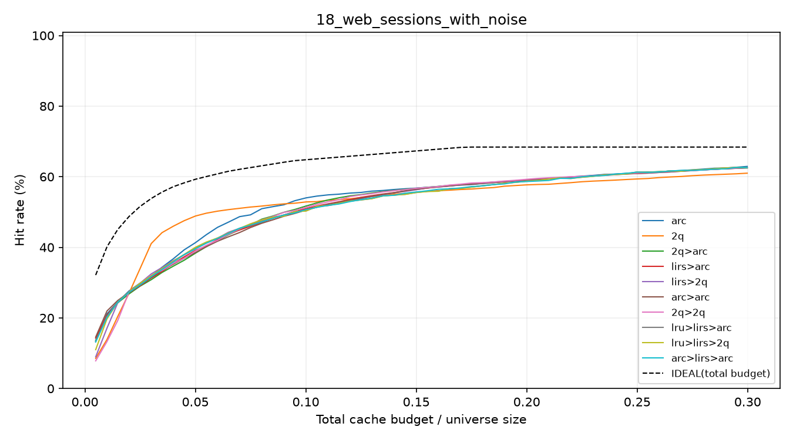</a>
    </td>
  </tr>
</table>

### Single-level algorithms

<table>
  <tr>
    <td width="50%" align="center" valign="top">
      <strong>Overall ranking</strong><br>
      <a href="assets/one/ranking.png">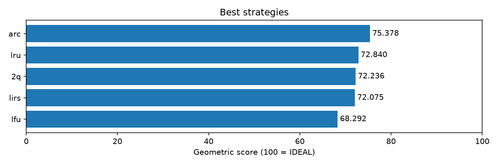</a>
    </td>
    <td width="50%" align="center" valign="top">
      <strong>Rating by ratio</strong><br>
      <a href="assets/one/ranking_by_ratio.png">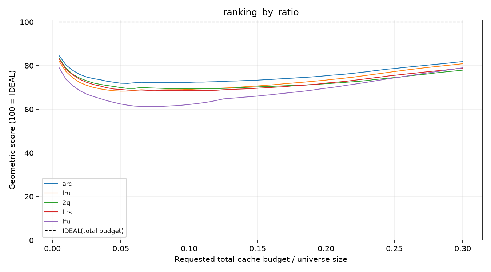</a>
    </td>
  </tr>
  <tr>
    <td width="50%" align="center" valign="top">
      <strong>Trace 12: Alternating hot regions</strong><br>
      <a href="assets/one/12_alternating_hot_regions.png">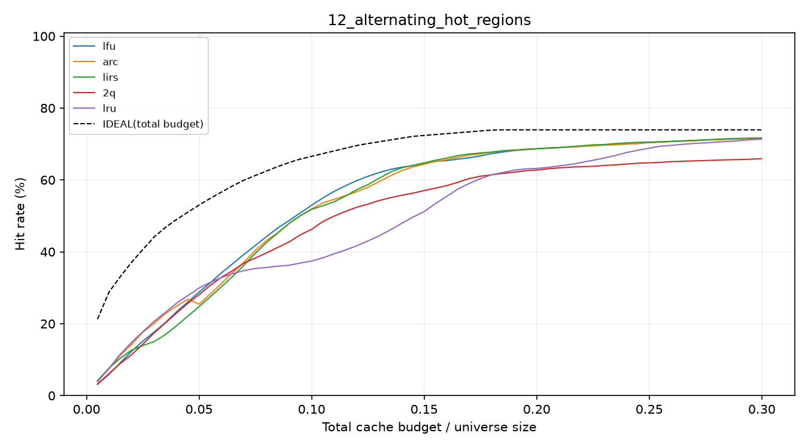</a>
    </td>
    <td width="50%" align="center" valign="top">
      <strong>Trace 15: Returning working sets</strong><br>
      <a href="assets/one/15_returning_working_sets.png">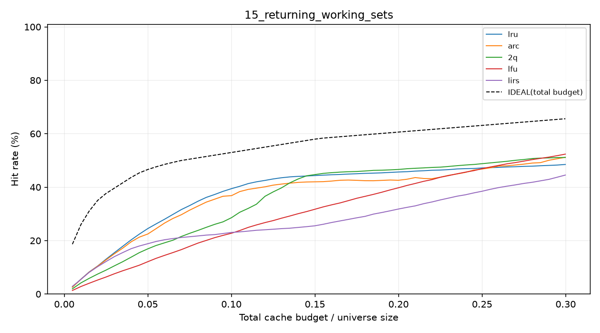</a>
    </td>
  </tr>
</table>

### Two-level strategies

The 25 combinations use a **1:3** capacity split.

<table>
  <tr>
    <td width="50%" align="center" valign="top">
      <strong>Overall ranking</strong><br>
      <a href="assets/two/ranking.png">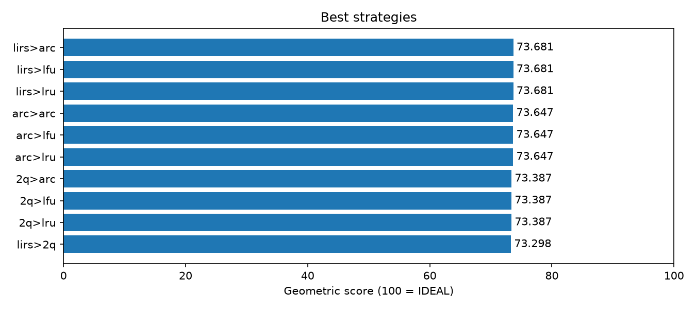</a>
    </td>
    <td width="50%" align="center" valign="top">
      <strong>Rating by ratio</strong><br>
      <a href="assets/two/ranking_by_ratio.png">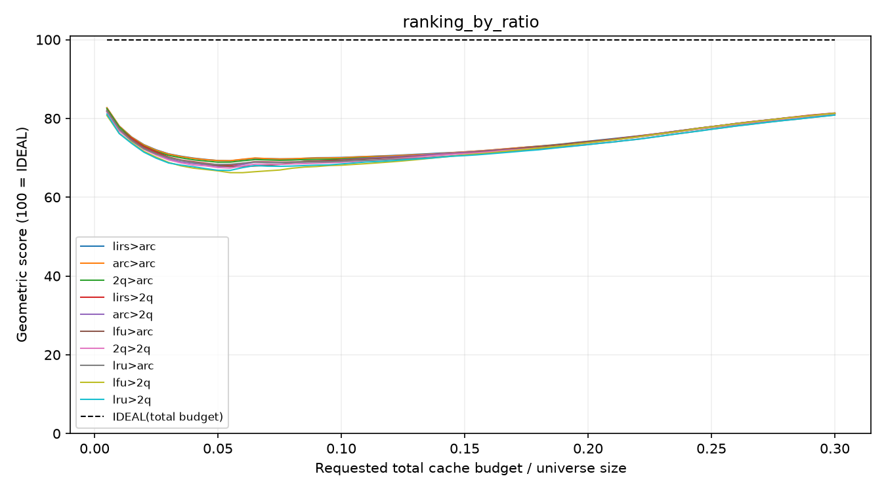</a>
    </td>
  </tr>
  <tr>
    <td width="50%" align="center" valign="top">
      <strong>Trace 8: Rotating working set</strong><br>
      <a href="assets/two/08_rotating_working_set.png">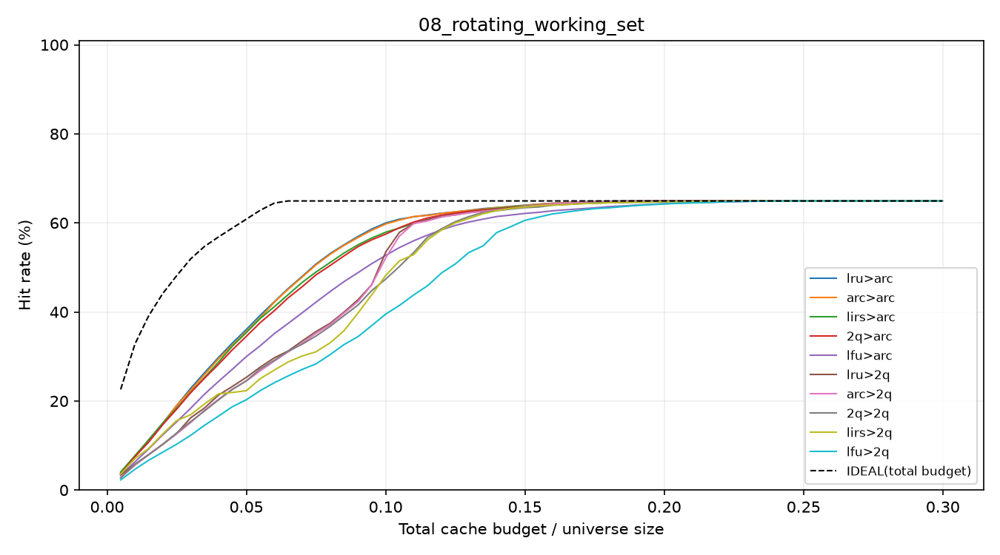</a>
    </td>
    <td width="50%" align="center" valign="top">
      <strong>Trace 13: Drifting popularity</strong><br>
      <a href="assets/two/13_drifting_popularity.png">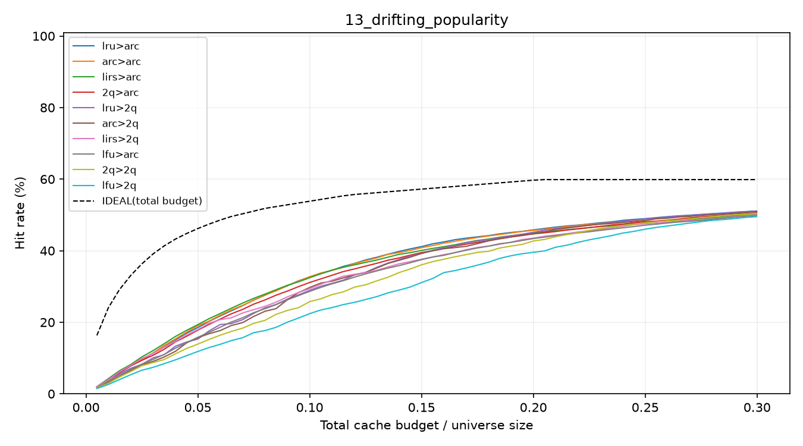</a>
    </td>
  </tr>
</table>

### Three-level strategies

The 125 combinations use a **1:3:5** capacity split.

<table>
  <tr>
    <td width="50%" align="center" valign="top">
      <strong>Overall ranking</strong><br>
      <a href="assets/three/ranking.png">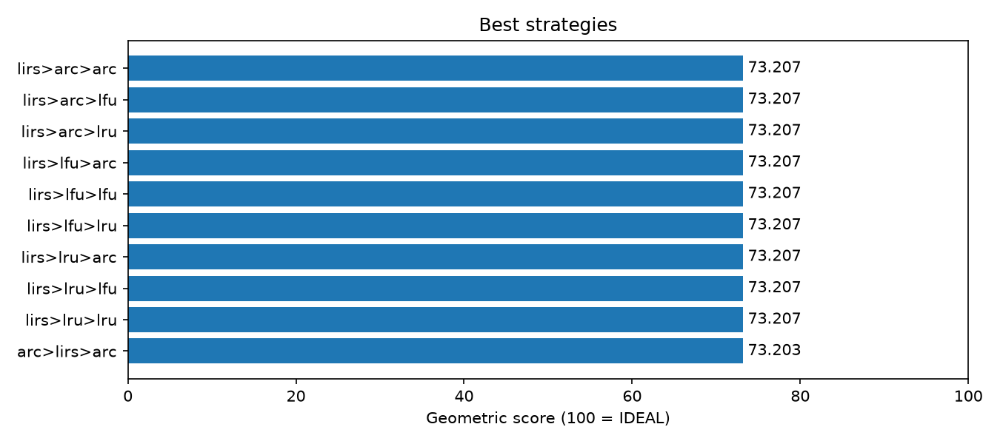</a>
    </td>
    <td width="50%" align="center" valign="top">
      <strong>Rating by ratio</strong><br>
      <a href="assets/three/ranking_by_ratio.png">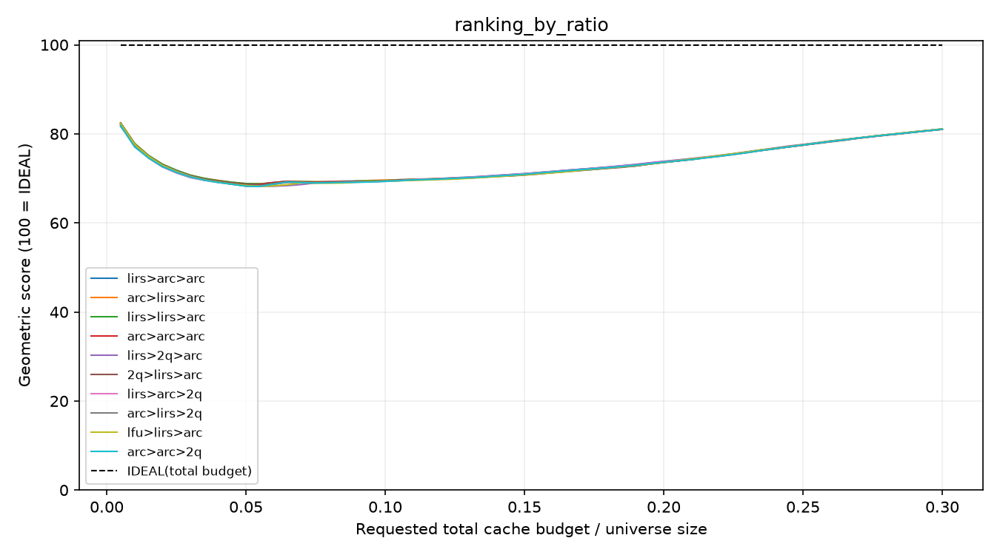</a>
    </td>
  </tr>
  <tr>
    <td width="50%" align="center" valign="top">
      <strong>Trace 15: Returning working sets</strong><br>
      <a href="assets/three/15_returning_working_sets.png">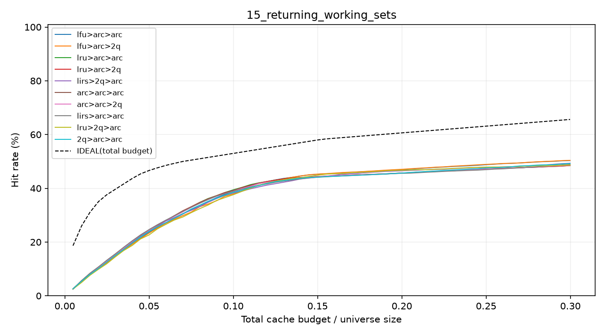</a>
    </td>
    <td width="50%" align="center" valign="top">
      <strong>Trace 13: Drifting popularity</strong><br>
      <a href="assets/three/13_drifting_popularity.png">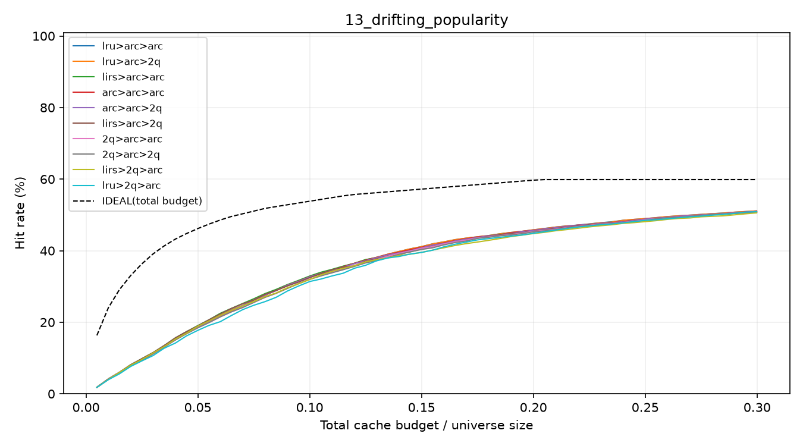</a>
    </td>
  </tr>
</table>
